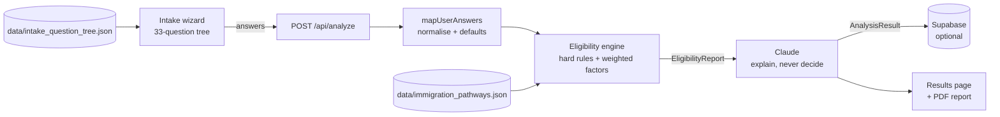

# Visa Wise

**A deterministic, rules-based engine that maps a person's profile to the Canadian immigration pathways they are likely to qualify for, then explains the result in plain English.**

[](https://github.com/Zoriyonz/visa-wise/actions/workflows/ci.yml)
[](LICENSE)


**Live:** <https://visa-wise.vercel.app> (free Canadian immigration pathway analysis)

> **Not legal advice.** Visa Wise is an informational prototype. Immigration rules change often and individual cases turn on details no questionnaire captures. Confirm everything against official sources or a licensed immigration professional.

## Contents

- [Overview](#overview)
- [Features](#features)
- [How it works](#how-it-works)
- [The rules data](#the-rules-data)
- [Tech stack](#tech-stack)
- [Project structure](#project-structure)
- [Getting started](#getting-started)
- [Configuration](#configuration)
- [Scripts](#scripts)
- [Testing and quality gates](#testing-and-quality-gates)
- [Automated data updates](#automated-data-updates)
- [Security and privacy](#security-and-privacy)
- [Design decisions](#design-decisions)
- [Known limitations](#known-limitations)
- [Roadmap](#roadmap)
- [License](#license)

## Overview

Immigration advice sits at an awkward intersection: the rules are public and precise, but the cost of a wrong answer is high, and a language model asked directly can sound confident while being wrong. Visa Wise splits the problem so the model never decides eligibility.

1. **A rules engine decides.** A person answers a short adaptive questionnaire. Their answers are scored against hard requirements and weighted soft factors encoded in a JSON dataset. The same answers always produce the same result.
2. **A language model only explains.** The computed result is handed to Claude with an instruction not to change any outcome, and it writes a plain-English summary, key gaps and next steps.

The product that is live today is Canada-focused. The dataset and engine also cover the United States, but the intake flow currently filters those questions out (see [Known limitations](#known-limitations)).

## Features

- **Adaptive intake wizard.** A 33-question tree in JSON with show and skip conditions, auto-filled answers and a progress indicator, so people only see questions that apply to them.
- **Deterministic eligibility scoring** across 13 Canadian pathways, including Express Entry streams, family sponsorship, Atlantic and rural programs, Quebec skilled workers and the Start-up Visa.
- **Hard disqualifiers handled explicitly.** Criminal inadmissibility and a prior removal order short-circuit every pathway and are explained.
- **Three outcome buckets:** qualifies, close, and not yet, each with the failed requirements, matched factors, unmet gaps and action steps.
- **Plain-English analysis** written by Claude from the computed result.
- **PDF report** generated in the browser with jsPDF.
- **Optional email capture** to save a lead.
- **Security headers** on every response and per-IP rate limiting on the analysis endpoint.

## How it works



### The eligibility algorithm

For each pathway in the selected country (`src/lib/eligibility/engine.ts`):

1. **Hard requirements.** Every requirement is a `field operator value` check (`eq`, `not_eq`, `gte`, `lte`, `gt`, `lt`, `in`, `not_in`). If any fails, the pathway scores `0`, is marked `not_yet`, and the error messages are returned.
2. **Soft factors.** Otherwise each matched factor adds `points x weight`. The sum is rounded to the pathway score.
3. **Status.** The score is compared with the pathway's two thresholds: at or above `qualifies` is _qualifies_, at or above `close` is _close_, anything lower is _not yet_.
4. **Gaps.** Each pathway can declare gap conditions in a tiny expression language (`field eq 'x' and other in [...]`). Matching gaps are listed.
5. **Country-level disqualifiers** are checked first. If one applies, every pathway becomes ineligible and the disqualifier message leads each result.

Action steps are returned only for pathways the person qualifies for or is close to.

### The intake flow

`src/lib/intake-engine.ts` walks the question tree. A question is shown when all its `show_if` conditions hold and none of its `skip_if` conditions do. Answers can auto-fill later questions (for example, entering 0 years of work experience fills the related destination-country field with 0, and a single marital status fills the spouse field). Baseline questions (age, education, English level, marital status) are asked in a fixed order after the goal question.

## The rules data

All domain knowledge lives in `data/`, not in code:

| File                             | Contents                                                                                                                                                                   |
| -------------------------------- | -------------------------------------------------------------------------------------------------------------------------------------------------------------------------- |
| `data/immigration_pathways.json` | Canada: 13 pathways, 11 provincial nominee streams, the CRS points table, processing times, hard disqualifiers. US: 29 pathways, visa bulletin dates, cap-exempt criteria. |
| `data/intake_question_tree.json` | The 33-question intake tree with show/skip conditions, auto-fill rules, help text and lawyer notes.                                                                        |

The pathways file records its version, data-as-of date, sources and per-section last-updated dates. Keeping rules as data means a policy change is a reviewable JSON diff, not a code change.

## Tech stack

| Area      | Choice                                                                   |
| --------- | ------------------------------------------------------------------------ |
| Framework | Next.js 16 (App Router), React 19                                        |
| Language  | TypeScript 5 in strict mode                                              |
| Styling   | Tailwind CSS 4, GSAP and Framer Motion for animation                     |
| AI        | Anthropic Claude via `@anthropic-ai/sdk` (explanations and data refresh) |
| Data      | Supabase (optional): submissions and leads                               |
| Payments  | Stripe routes exist but are dormant (the product is free)                |
| PDF       | jsPDF, in the browser                                                    |
| Testing   | Vitest                                                                   |
| Quality   | ESLint (`eslint-config-next`), Prettier, GitHub Actions                  |
| Hosting   | Vercel                                                                   |
| Packages  | pnpm 10, Node 20 or newer (`.nvmrc` pins 22)                             |

## Project structure

```
visa-wise/
├── data/                              Rules and questionnaire as JSON
├── scripts/
│   └── update-immigration-data.mjs    Weekly data-refresh script (Claude + official pages)
├── src/
│   ├── app/
│   │   ├── api/
│   │   │   ├── analyze/               Eligibility + Claude analysis, rate limited
│   │   │   ├── results/               Fetch a saved result by id
│   │   │   ├── save-lead/             Email capture
│   │   │   ├── checkout/, webhook/    Dormant Stripe routes
│   │   ├── form/                      Intake wizard page
│   │   ├── results/                   Results page and cards
│   │   └── page.tsx, terms/, layout.tsx
│   ├── components/                    landing/, form/, results/ and shared UI
│   ├── lib/
│   │   ├── eligibility/               engine.ts (tested), types.ts
│   │   ├── intake/                    conditions, path, answer mapping (tested)
│   │   ├── intake-engine.ts           Question-tree walker (tested)
│   │   ├── ai.ts                      Claude explanation call
│   │   ├── supabase.ts                Optional database client
│   │   └── pdf/generateReport.ts      Browser PDF report
│   └── test/server-only.ts            Vitest stub for the server-only package
├── .github/workflows/
│   ├── ci.yml                         Format, lint, typecheck, test, build
│   └── update-immigration-data.yml    Weekly data refresh as a pull request
├── .env.example
└── vitest.config.ts
```

## Getting started

Requires Node 20 or newer and [pnpm](https://pnpm.io) 10.

```bash
git clone https://github.com/Zoriyonz/visa-wise.git
cd visa-wise
pnpm install
cp .env.example .env.local
pnpm dev                       # http://localhost:3000
```

The intake wizard and the eligibility engine need no configuration. The plain-English analysis needs `ANTHROPIC_API_KEY`.

## Configuration

All variables are optional for local development. Anything that needs a missing value degrades as described.

| Variable                    | Used by                        | Purpose and behavior when missing                                                                  |
| --------------------------- | ------------------------------ | -------------------------------------------------------------------------------------------------- |
| `ANTHROPIC_API_KEY`         | `src/lib/ai.ts`, update script | Writes the explanation and refreshes data. Without it, `/api/analyze` returns an error.            |
| `NEXT_PUBLIC_SUPABASE_URL`  | `src/lib/supabase.ts`          | Supabase project URL. Without it, nothing is persisted and saved results cannot be reloaded by id. |
| `SUPABASE_SERVICE_ROLE_KEY` | `src/lib/supabase.ts`          | Server-only key for inserts and reads. Never exposed to the browser.                               |
| `NEXT_PUBLIC_SITE_URL`      | `src/app/api/checkout`         | Base URL for Stripe redirects. Defaults to `http://localhost:3000`.                                |
| `STRIPE_SECRET_KEY`         | `checkout`, `webhook` routes   | Only for the dormant paid-report flow.                                                             |
| `STRIPE_WEBHOOK_SECRET`     | `src/app/api/webhook`          | Verifies Stripe webhook signatures.                                                                |

## Scripts

| Command             | What it does                                        |
| ------------------- | --------------------------------------------------- |
| `pnpm dev`          | Start the dev server                                |
| `pnpm build`        | Production build                                    |
| `pnpm start`        | Serve the production build                          |
| `pnpm lint`         | ESLint                                              |
| `pnpm typecheck`    | `tsc --noEmit`                                      |
| `pnpm test`         | Vitest unit tests                                   |
| `pnpm format`       | Format everything with Prettier                     |
| `pnpm format:check` | Fail if anything is not formatted (used in CI)      |
| `pnpm data:update`  | Run the data-refresh script locally (needs the key) |

## Testing and quality gates

28 unit tests run without network access, a database or an API key:

- **`eligibility/engine.test.ts`** checks that a strong profile qualifies for the Federal Skilled Worker Program, that every pathway lands in exactly one bucket for both countries, that failed hard requirements score zero, that criminal history and prior removal disqualify everything, and that results are deterministic.
- **`intake/mapUserAnswers.test.ts`** checks defaults, type coercion and the handling of bad input.
- **`intake/conditions.test.ts`** covers the condition operators, show/skip logic and the auto-fill expression parser.
- **`intake-engine.test.ts`** walks the whole question tree and checks that progress never goes backwards and no question is asked twice.

CI runs `format:check`, `lint`, `typecheck`, `test` and `build` on every push and pull request.

## Automated data updates

`update-immigration-data.yml` runs every Monday (and on demand). It fetches official pages (Canada.ca, the IRCC CRS tool, the US visa bulletin), asks Claude to propose updates to `data/immigration_pathways.json`, and opens a **pull request** labelled `data-update` if anything changed. A human reviews the diff against the official source before merging. The model never writes to the live rules unreviewed.

## Security and privacy

- Eligibility is computed server-side by the deterministic engine. The model receives the finished result and is told not to alter it.
- `/api/analyze` validates the body and is limited to 3 requests per hour per IP (in memory, so per server instance).
- The Supabase service-role key and Stripe secrets are only read in server routes.
- Responses carry `X-Frame-Options: DENY`, `X-Content-Type-Options: nosniff`, a strict `Referrer-Policy`, a restrictive `Permissions-Policy` and HSTS (`next.config.ts`).
- If Supabase is configured, intake answers, the computed report and the analysis are stored with a generated id, and email leads go to a separate table. No account system exists.
- The webhook verifies Stripe's signature before it trusts an event.

## Design decisions

- **Rules as data.** Pathway criteria are JSON with weights, thresholds and error messages, so non-engineers can review them and the engine stays small and testable.
- **The model explains, it does not decide.** Eligibility is the part where being wrong matters, so it is the part with no model in it.
- **Human review for data changes.** The weekly updater opens a pull request instead of committing, because a language model reading government pages can be wrong.
- **One source layout.** Everything lives under `src/` with a single `@/` alias and an `@data/` alias, matching the other projects in this account.

## Known limitations

- **Canada only in the live flow.** The engine and dataset support the US, but `intake-engine.ts` removes US-only questions and starts on Canada. Re-enabling it needs UX work and a data review.
- **No deterministic fallback.** If the Claude call fails, `/api/analyze` returns an error even though the eligibility result is already computed.
- **Scores are heuristics, not official calculations.** The weights approximate how strongly a factor helps; they are not the government's scoring.
- **Rate limiting is per instance.** On serverless hosting it deters casual abuse but is not a hard guarantee.
- **The gap expression parser is minimal.** It handles the conditions present in the data, not arbitrary expressions.
- **The Stripe checkout and webhook routes are unused** by the free product and kept for a possible paid report.
- **Coverage is focused on the core logic.** Components and API routes are not unit tested.

## Roadmap

- Return the deterministic result even when the explanation call fails.
- Add Playwright end-to-end tests for the wizard and results page.
- Re-enable the US flow behind a country selector.
- Cache explanations by report hash.

## License

[MIT](LICENSE) © 2026 Zoriyon Zion
